# 阿尔茨海默病 AI+体感康复平台 - 客户原型图集

本图集用于客户沟通阶段，采用图片形式展示核心产品闭环：

`登录/授权 -> AI 评估 -> 风险分级 -> 个性化方案匹配 -> Unity/体感训练 -> 数据回传 -> 医师调整 -> 家属协同 -> 后台审计`

## 1. 登录与角色入口

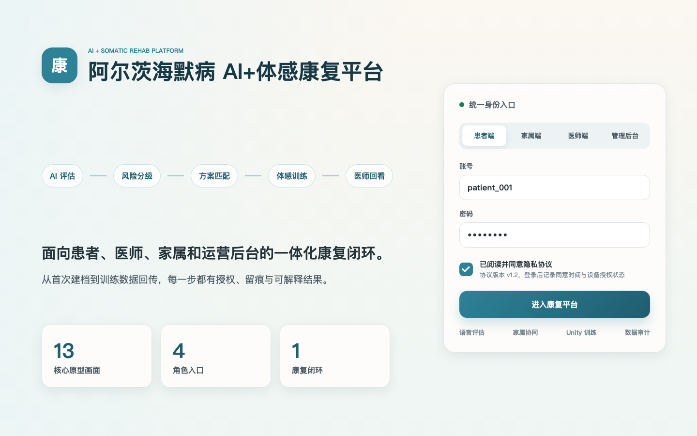

## 2. 患者建档与知情同意

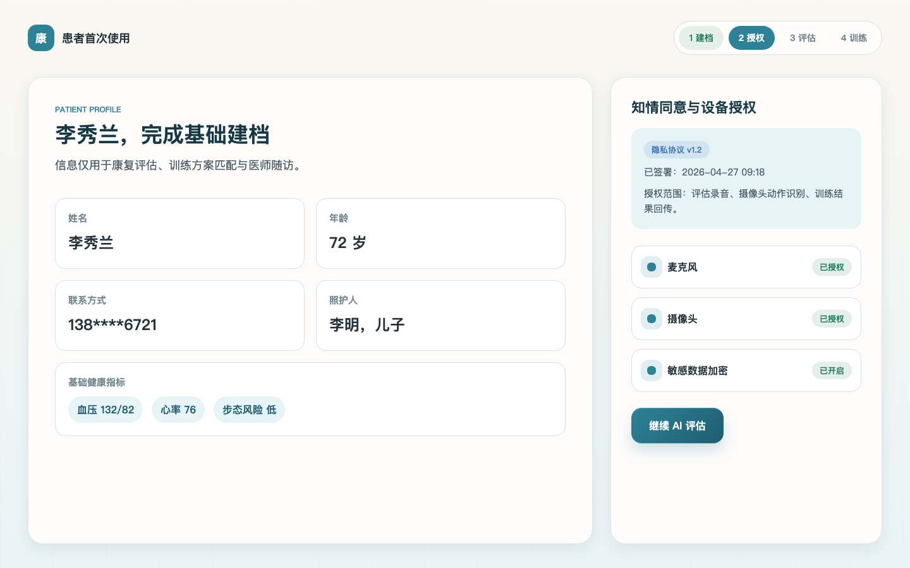

## 3. AI 语音评估

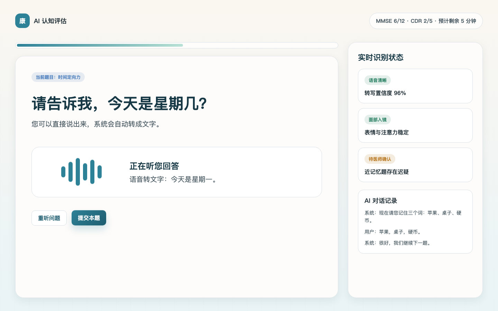

## 4. 评估结果与智能匹配

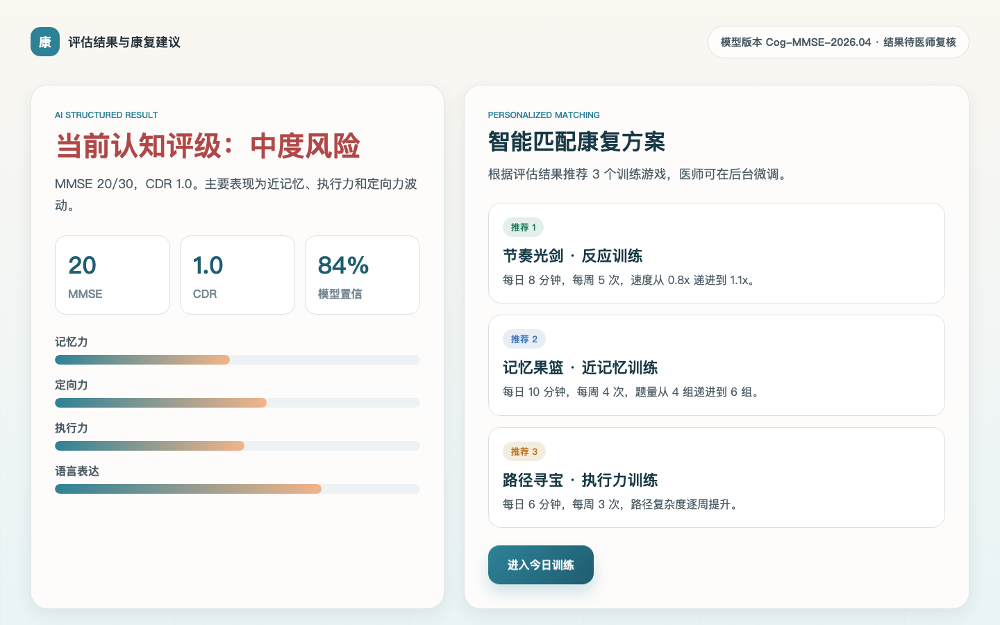

## 5. 患者今日训练

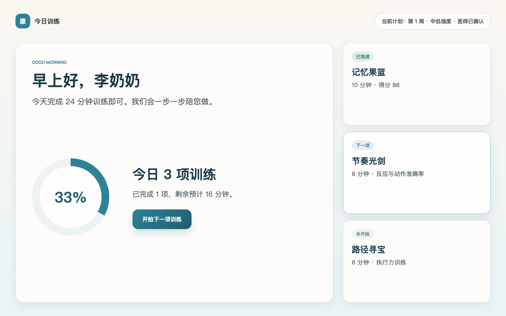

## 6. Unity 训练准备

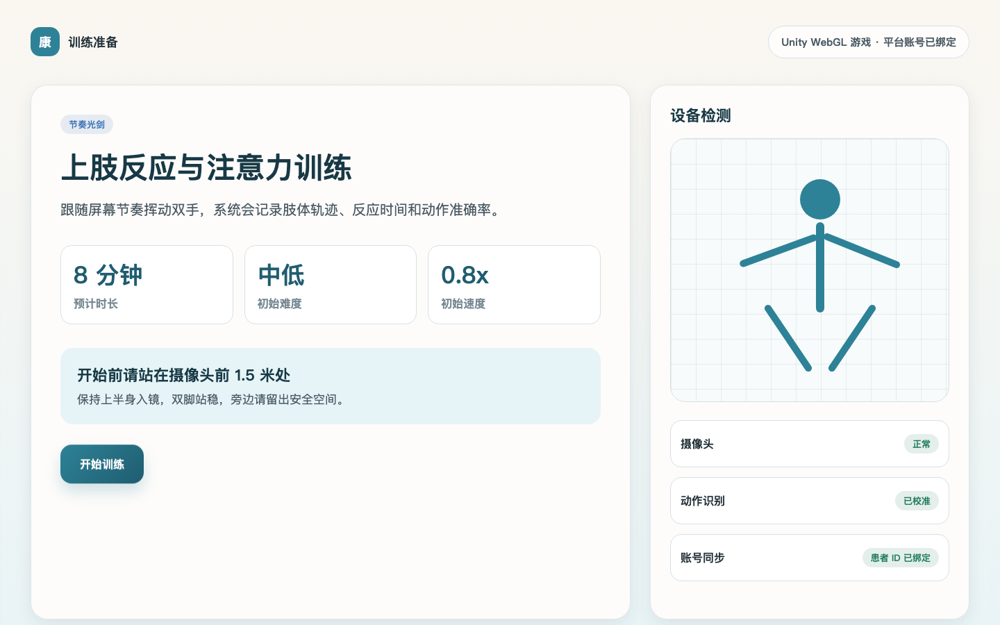

## 7. 游戏实时采集反馈

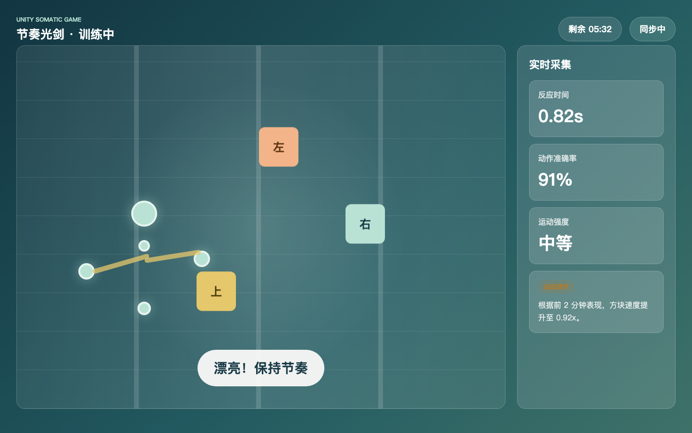

## 8. 训练结果与历史记录

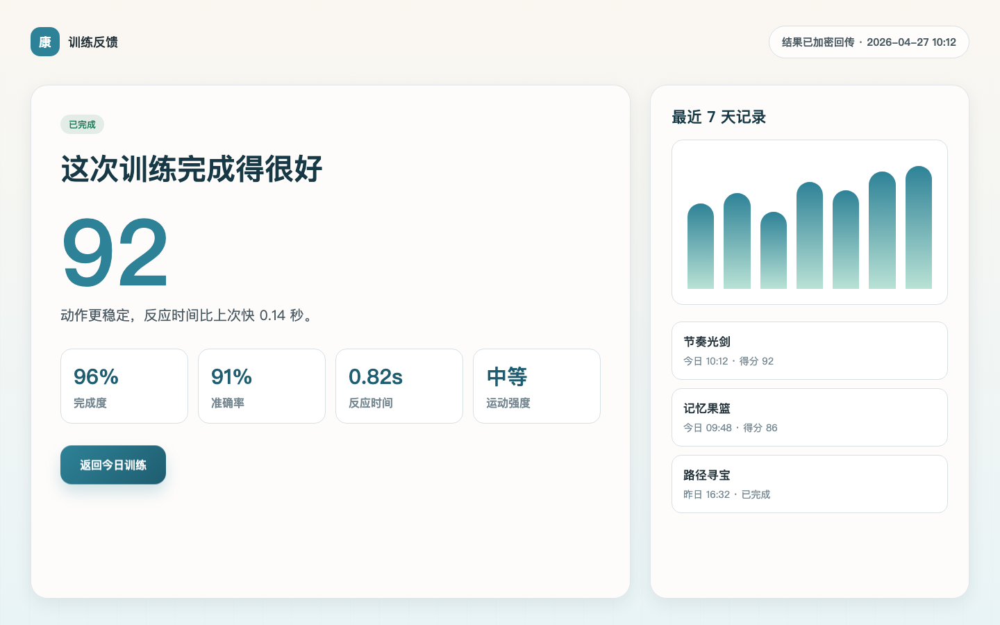

## 9. 医师患者详情总览

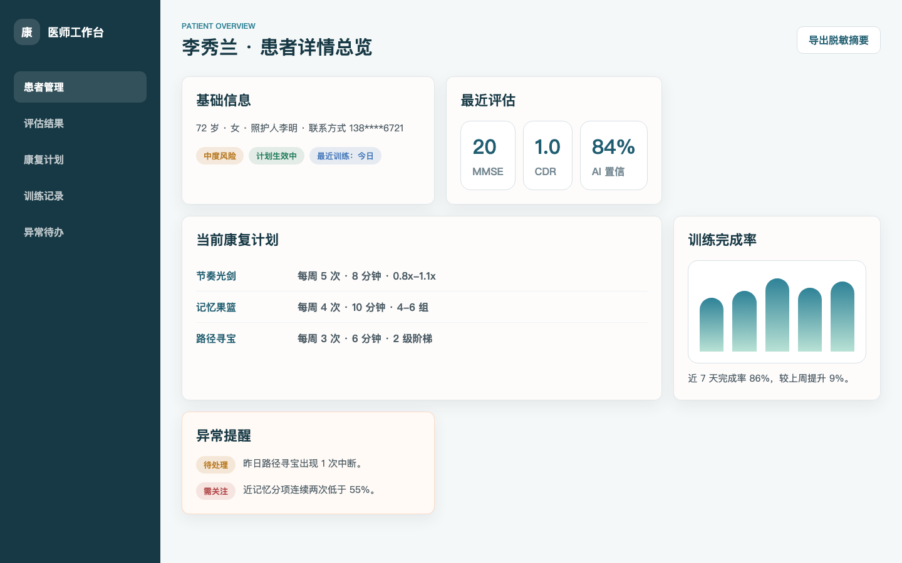

## 10. 医师康复计划编辑

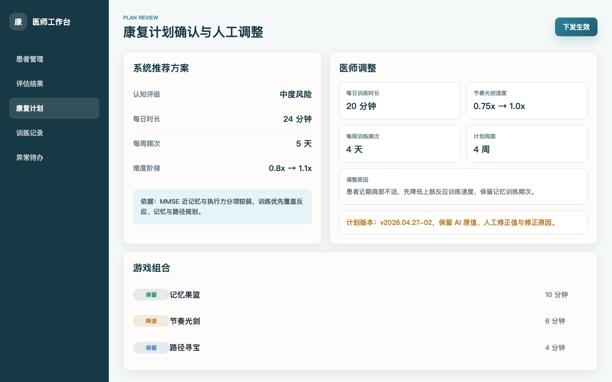

## 11. 管理后台运营概览

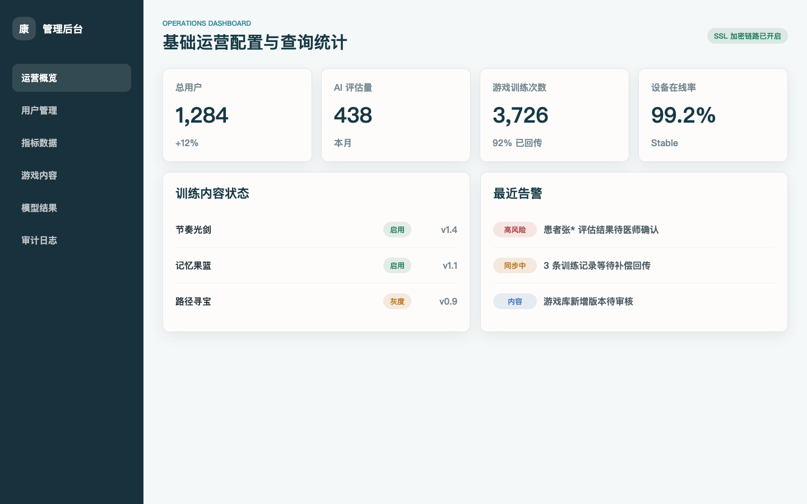

## 12. 安全隐私与审计

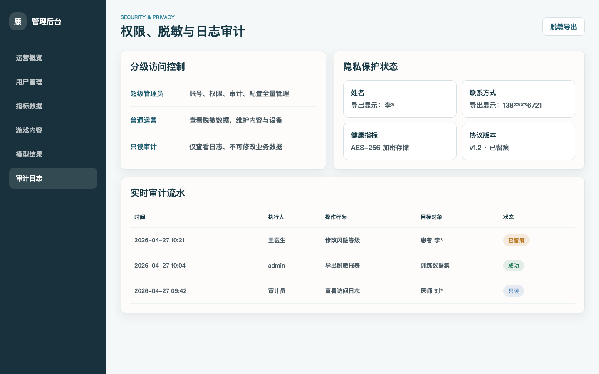

## 13. 家属登录与授权绑定

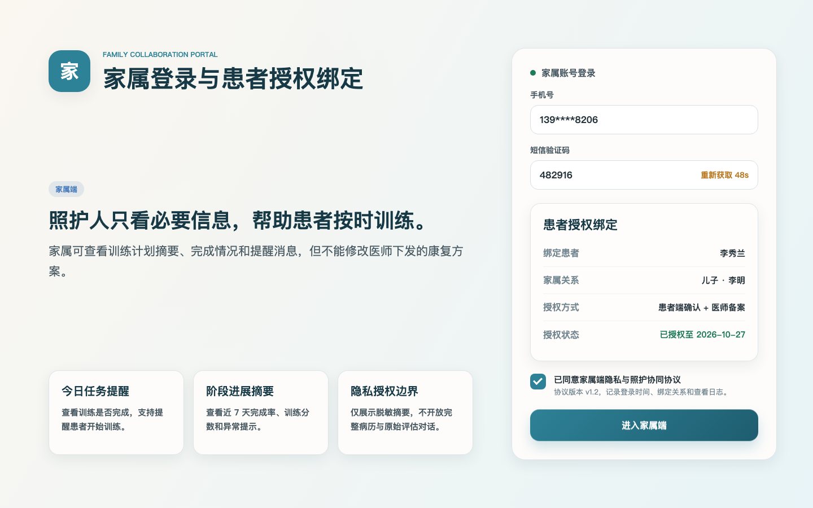

## 文件说明

- 图片目录：`docs/prototype-captures-client/`
- 原型源文件：`docs/prototype-static/index.html`
- 样式文件：`docs/prototype-static/styles.css`
- 截图脚本：`docs/prototype-static/capture-prototypes.mjs`
