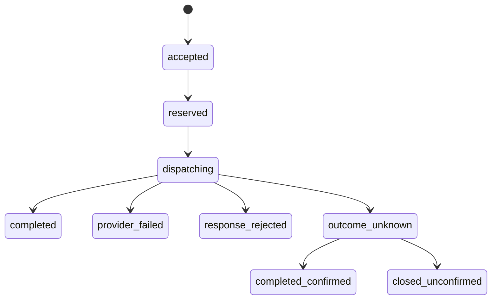

# MiMo Outcome And Outbox Design

**状态：** 第一阶段已实施，尚未具备完整人工对账、资产管理或受控结果读取能力。本文同时记录已落地的 operation/outbox/case 基础设施和后续目标架构；未实现项目不得作为上线能力表述。

## 实施状态（2026-07-23）

已实施：

- `ProviderOperation`、`ProviderOperationOutbox` 和 `ProviderOutcomeCase` 的加性迁移；可空作用域使用 PostgreSQL `UNIQUE NULLS NOT DISTINCT`，同键同作用域不会因 `NULL` 而重复；另以不含客户端键的 `requestIntentHmac` partial unique index 阻断同一患者同一操作的未决意图换键重发。
- 集中 `ProviderOperationService`：规范化请求 HMAC、AES-256-GCM 加密请求/结果、独立响应 HMAC、`accepted -> reserved -> dispatching` 条件迁移、终态 outbox，以及 `outcome_unknown` 的案件创建。它不发起 HTTP 调用，也没有重试路径。
- AI 草稿、连续会话、STT 和 TTS 的**生产**外呼窗口都先创建 operation，再经 Redis 预留、标记发送后外呼。成功路径将完成账本与最小审计放入同一事务；连续会话也将成对消息和会话版本放入该事务。既有终态或 `dispatching` operation 会阻断再次外呼；同键异请求返回冲突。
- TTS operation 只保存结果元数据和音频哈希证据，绝不把 Base64 音频写入 operation、audit 或 telemetry。
- PostgreSQL 迁移将 operation 类型、状态、HMAC 格式、生命周期时间线、完成证据和失败分类下沉为 `CHECK` 约束；不合规历史记录会使迁移失败，不会自动改写记录。

尚未实施且仍为 Production 阻断项：跨刷新/跨实例的结果查询 API 与页面、outbox 投递 worker、人工案件工作台、供应商状态查询、TTS 加密资产存储/删除、财务预留/结算，以及在真实临床链路上的端到端验收。现有 `completed` 记录不会自动向重复请求返回原业务结果；它只确保不会再次外呼。

## 1. 目标与边界

当前四条高成本链路都会在外部 MiMo 调用成功后写入本地业务、审计或 telemetry。因此，供应商已完成但本地事务或 HTTP 回包失败时，系统无法可靠判断结果是否应再次请求。

本设计的目标是将每次高成本意图变成可追踪、可审计且不能重复外呼的持久化 operation：

- 同一身份和相同请求只允许一次供应商调用。
- 同键但不同请求在任何外呼前返回冲突。
- 供应商结果、业务写入、审计与待投递事件有明确的事务边界。
- 不确定结果进入人工对账，不重试、不换新键、不虚构结果。
- 原始输入、模型输出、转写和音频不进入日志、telemetry、Redis 或普通审计 metadata。

不在本设计中实现的行为：自动供应商重试、自动新键重投、供应商切换、默认退款/额度释放、未授权的数据留存或恢复。

## 2. 固定技术决策

1. `ProviderCallTelemetry` 继续是可清理的最小化遥测，不能承担调用账本、结果恢复或财务结算职责。
2. 新的 `ProviderOperation` 是每次外部调用的唯一事实来源。客户端幂等键、机构、患者、执行者、操作类型和规范化请求 HMAC 共同确定一个 operation。
3. outbox 只投递已经提交的审计、告警和人工对账事件；它绝不执行或重新执行供应商 HTTP 调用。
4. 调用的原始请求和结果使用现有 AES-256-GCM 信封加密，AAD 固定绑定 `provider_operation`、operation UUID 与字段名。
5. Redis 配额门仍在外呼前拒绝超额请求，但它不是持久化 outcome 存储。
6. 所有不确定结果均 fail closed 为 `outcome_unknown`，前端只能显示待核对状态，不能显示“重试”或自动发起新请求。

## 3. 数据模型

### 3.1 `ProviderOperation`

| 字段组     | 内容                                                                                                            |
| ---------- | --------------------------------------------------------------------------------------------------------------- |
| 身份       | `id`、`organizationId`、`patientId`、`actorUserId`、`operation`、`clientIdempotencyKey`                         |
| 请求一致性 | `canonicalRequestHmac`、加密 `requestCiphertext`、预期业务对象和版本                                            |
| 供应商事实 | `provider`、`modelVersion`、`endpointHost`、`apiKeyRef`、`promptVersion`、`providerCallId`、`providerRequestId` |
| outcome    | 状态、加密 `responseCiphertext`、响应 HMAC、失败分类、供应商开始/响应/完成时间                                  |
| 审计       | 创建、更新时间及最终状态时间                                                                                    |

唯一约束为：

```text
(organizationId, operation, patientId, actorUserId, clientIdempotencyKey)
```

同一唯一键再次提交时，服务比较 `canonicalRequestHmac`、供应商、模型、endpoint 主机、密钥引用、提示词版本和预期业务对象。任一项不同均返回 `409`，不调用 MiMo。第一阶段对相同且语义一致的请求仅允许继续尚未进入共享配额的 `accepted` operation；持久化 `reserved` 无法证明 Redis 预留仍有效，必须阻断外呼并等待人工处置，终态和 `dispatching` 同样一律阻断。受控结果读取属于后续工作。

即使客户端换用新键，服务仍以不含客户端键、执行者和供应商配置的 `requestIntentHmac` 识别同一机构、患者和操作的业务意图。任一相同意图的既有记录都会返回不泄露归属的 `409`；同一意图的不同医生、配置或实例都不能再次外呼。历史 `requestIntentHmac=NULL` 的未决记录按患者和操作宽范围阻断，直至人工关闭或受控回填。明确终态能否以新键建立新的独立意图，须由客户冻结结果读取、对账和计费规则后另行实现，当前不推断放行。

建议索引：`(status, updatedAt)`、`(patientId, createdAt)`、`providerCallId` 和 `providerRequestId`。不修改历史 `ProviderCallTelemetry` 数据，也不将 outcome 接入其现有清理任务。

### 3.2 `ProviderOperationOutbox`

每个 operation 在接受、完成、失败或进入人工对账时，以同一事务创建最小化事件。字段包括 operation 外键、事件类型、状态、可用时间、领取令牌、领取时间、处理时间、尝试次数和脱敏失败分类。

唯一约束为 `(providerOperationId, eventType)`。outbox worker 只能处理已提交事件，不得据此重放 MiMo 请求。

### 3.3 `ProviderOutcomeCase`

仅在 `outcome_unknown`、供应商状态查询不一致、结果写入冲突或人工结算待确认时创建。它保存责任人、SLA、最小化证据引用、关闭动作和关闭时间；不得保存原始临床材料、原始音频或供应商原始响应。

### 3.4 `ProviderAsset`（未实施）

仅 TTS 使用。它保存加密资产位置、内容类型、字节数、内容 HMAC、有效期和删除状态。音频不得写入 audit metadata、telemetry 或 Redis。资产读取必须经过患者访问关系和短时受控授权，不能返回永久公开 URL。

### 3.5 `ProviderFinancialReservation`（未实施）

它记录可审计的预留、待确认和人工关闭状态，与 Redis 的窗口限额分离。该表不会自动扣费、退款或释放额度；结算动作必须由最终批准的政策驱动。

## 4. 状态机



- `accepted`：权限、同意、输入和同键请求一致性已验证，operation、初始审计和 outbox 在一个本地事务中创建。
- `reserved`：Redis 配额预留成功且已记录最小化状态。
- `dispatching`：条件更新取得唯一发送权。进程在此状态中断时，后续只能对账，不能再次外呼。
- `completed`：加密结果、业务效果、最小审计、telemetry 事件和完成状态已在同一事务提交。
- `provider_failed`：供应商有明确失败证据，且最终批准的查询/计费政策确认未完成。
- `response_rejected`：HTTP 成功但 MIME、JSON、schema 或结果合同无效。
- `outcome_unknown`：超时、网络中断、客户端断开、已收到响应后本地提交失败、结果无法按加密合同保存、审计失败或 telemetry 失败等不能证明“供应商未执行”的情形。

`outcome_unknown` 只允许走状态查询或人工对账；不允许自动重发、人工以新键重发或把重复键拒绝表述为恢复成功。

## 5. 目标事务与调用顺序

以下是完整目标架构，不是对第一阶段原子性的声明：

1. 入口校验身份、患者访问、同意、输入和 current request identity。
2. 在数据库事务中创建或读取 `ProviderOperation`、初始审计与 `accepted` outbox 事件。唯一键冲突时仅返回现有 operation。
3. 通过 Redis 配额后，以条件更新将 operation 标记为 `reserved`。
4. 以条件更新从 `reserved` 获取唯一的 `dispatching` 发送权，然后在数据库事务外调用 MiMo 一次。
5. 供应商成功并通过响应校验后，在一个数据库事务中写入加密 outcome、对应业务效果、最小审计、telemetry 记录、完成 outbox 事件和 `completed` 状态。
6. 供应商明确失败或响应被拒绝时，以事务写入对应失败状态、最小审计和 outbox 事件。
7. 第 5 步提交失败、HTTP 回包中断或任何执行状态无法证明外呼未发生时，保留 operation 并进入 `outcome_unknown`，创建人工对账案件和事件。

外部 HTTP 调用永远不放在数据库事务内。四条成功路径的 operation `completed` 终态和最小审计现已使用同一个数据库事务提交；连续会话还包括已校验响应、成对消息和会话版本。任一写入失败会整体回滚并以 `outcome_unknown` 进入人工处置；这不重发供应商请求。telemetry 的异步投递失败不能覆盖已提交的业务结果，但必须保留待投递事件和运行事件。

## 6. 四类业务效果

| operation           | 成功时的业务效果                                  | 禁止行为                     |
| ------------------- | ------------------------------------------------- | ---------------------------- |
| `assessment_draft`  | 加密保存 AI 草稿，状态保持 `pending_human_review` | 自动创建正式评估             |
| `conversation_turn` | 加密保存成对的用户/助手消息；版本冲突进入对账     | 重新发送相同问题             |
| `speech_transcript` | 加密保存转写结果及最小调用证据，供人工检查        | 用本地转写或固定文本代替     |
| `tts_output`        | 保存结果元数据和受控加密资产引用                  | 在日志或审计保存 Base64 音频 |

连续会话已将 `ProviderOperation` 的完成写入现有会话消息事务，避免“消息已提交但 outcome 未完成”或反向分裂；该路径有不嵌套事务的定向回归覆盖。

## 7. 权限、加密与保留

- 患者与医师仅能按现有患者访问关系读取其被允许的业务结果；审计人员默认只见最小化 operation/case 元数据。
- 解密 outcome 和 TTS 资产要求独立的受控角色授权，并记录访问审计。
- 请求信封、结果信封和 TTS 资产分别使用明确的 AAD 字段与保留任务；任何留存删除都留下最小化完成证据。
- audit、financial、outcome、asset 和 telemetry 的留存期相互独立，不能复用 telemetry 的现有 30 天清理语义。

## 8. 最终批准前必须冻结的值

下列值在实现前必须从 `PENDING_FINAL_APPROVAL` 变为可审计的正式配置，不能由代码猜测：

1. MiMo 的幂等字段、传输位置、作用域、有效期和可查询状态合同。
2. 未知结果的责任人、SLA、供应商升级路径和关闭证据。
3. 预留、计费、退款或额度释放的人工结算规则。
4. TTS 资产的加密存储类别、访问角色、合法依据、留存期和安全删除证据。
5. 新付费请求的批准角色和流程。

这些值由 [MiMo policy template](templates/mimo-provider-outcome-policy.template.json) 承载。模板通过校验仅表示输入完整；它不会自动使本设计成为已实现功能。

## 9. 实施分组与回归

1. **第一阶段，已完成：** 新增 operation、outbox、case，不改 telemetry 表、不回写历史记录；新增集中 service 并接入四个正式外呼窗口。
2. **第二阶段，未完成：** 新增 asset 和 financial reservation，冻结客户批准的存储、删除、结算和状态查询合同。
3. **第三阶段，未完成：** 为 outbox 投递、人工案件与各类保留创建独立 worker；供应商调用不由 worker 自动重放。
4. **第四阶段，未完成：** 对已存在 operation 显示受控状态并提供最小授权的已保存结果读取；未知结果不显示重试入口。
5. **回归，部分完成：** 已覆盖 HMAC、同键冲突、状态迁移、加密、迁移和 AI 草稿生产调用窗口；仍须覆盖同键同负载并发、发送后数据库失败、审计/telemetry 失败、TTS 资产权限、撤回同意、过期删除、人工关闭和越权读取。

验收原则是“调用次数最多一次且状态可解释”，而不是以重新调用供应商换取表面成功。

## 10. 当前代码对齐点

- `apps/api/src/app.service.ts` 中 AI 草稿、连续会话、STT、TTS 的生产外呼窗口由集中 service 接管。
- `apps/api/src/provider-operation.service.ts` 负责持久化状态机、加密和 outbox；`apps/api/src/provider-operation.ts` 负责不依赖数据库的规范化 HMAC 与状态约束。
- `apps/api/src/mimo-usage-gate.ts` 保留为外呼前的 Redis 限额门。
- `apps/api/src/provider-request.ts` 继续负责受限 HTTP 传输与错误分类。
- `apps/api/src/provider-telemetry.service.ts` 只从已提交的 operation 状态生成最小化遥测。
- `packages/db/src/sensitive-encryption.ts` 继续提供 AES-256-GCM envelope；新表通过独立 AAD 使用它。
