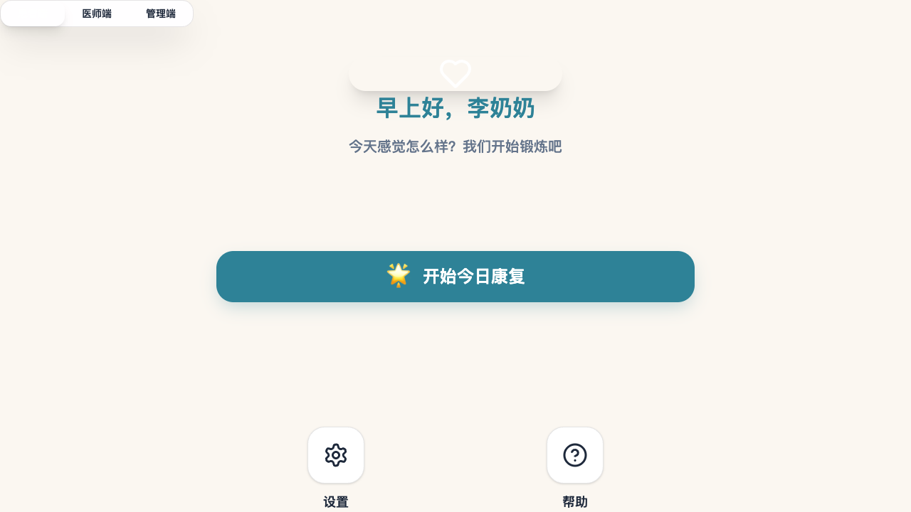
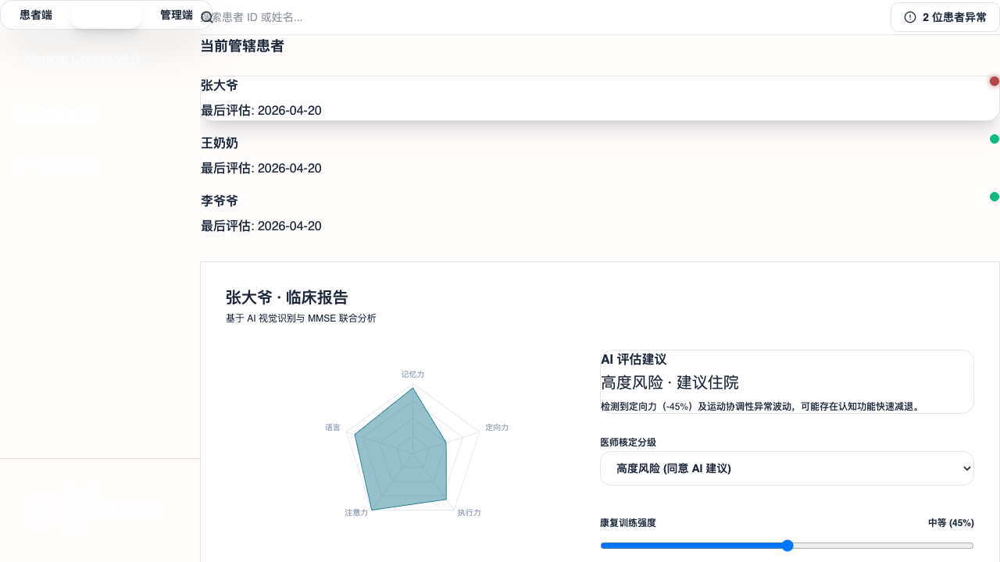
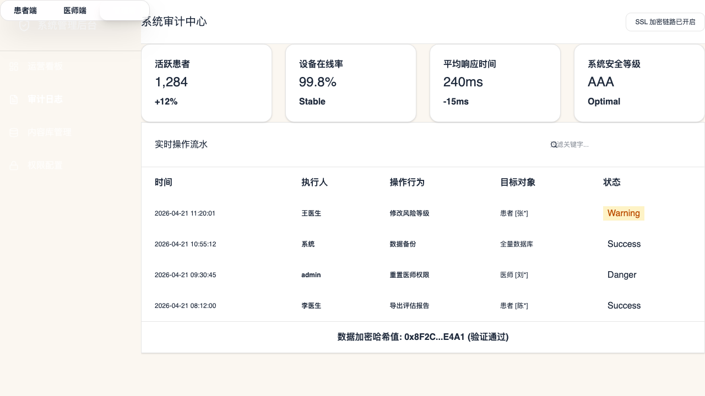

# 阿尔茨海默病 AI+体感康复平台 - 高保真原型图集

本项目原型采用 **Warm Clinical Calm** (温暖临床冷静感) 视觉体系，旨在为患者提供安全感，为医生提供高效决策支撑。

## 1. 患者端 (Patient End) - 适老化极简设计
- **核心理念**：一屏一事，极低认知负担。
- **视觉特征**：#FBF7F1 温暖背景，20px+ 特大字号，72px 高度呼吸感主按钮。

---

## 2. 医师端 (Physician End) - 临床决策中心
- **核心理念**：数据驱动，人机协作决策。
- **视觉特征**：集成 Recharts 雷达图，实时风险预警（红/黄/绿点），AI 建议与人工核定对照。

---

## 3. 管理员端 (Admin End) - 系统治理后台
- **核心理念**：合规审计，全流程可控。
- **视觉特征**：深色稳重风格，实时运营驾驶舱，脱敏处理的操作日志流水。

---

**交付文件位置**：`docs/prototype-captures/`
