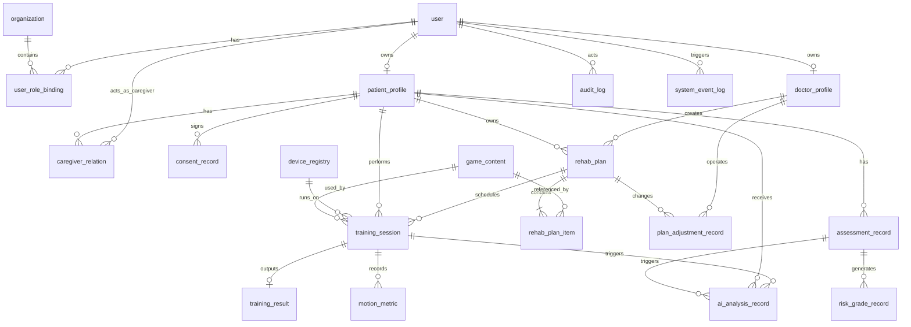

# 阿尔茨海默病 AI+体感康复平台 核心数据模型与 ER 草图

## 1. 文档说明

- 文档版本：`v0.1`
- 文档用途：用于后端数据建模、接口设计、权限设计、前端字段对齐、审计与合规方案对齐
- 依赖文档：
  - [rehab-platform-mvp-prd.md](/Users/thl/IdeaProjects/Rehabilitation platform/docs/rehab-platform-mvp-prd.md)
  - [rehab-platform-role-flows-and-pages.md](/Users/thl/IdeaProjects/Rehabilitation platform/docs/rehab-platform-role-flows-and-pages.md)

## 2. 建模原则

1. 先满足 `MVP 闭环`，不为远期大平台过度设计。
2. 以“患者”为核心主实体，评估、计划、训练、结果都围绕患者聚合。
3. 所有关键业务对象必须支持 `状态`、`创建时间`、`更新时间`、`操作人` 或 `来源`。
4. AI 输出在 MVP 阶段定位为 `辅助建议`，必须保留来源、版本与人工确认痕迹。
5. 同一患者在同一时间只能存在一个 `当前生效康复计划`。
6. 默认不长期保存完整视频流，只保留 `训练结果级` 与 `关键指标级` 数据。
7. 敏感字段默认按“最小必要、最小权限、默认保护”设计。

## 3. 推荐技术假设

本阶段推荐按关系型数据库思路建模，建议默认目标数据库为 `PostgreSQL`。

原因：

- 强关系数据多
- 状态流与审计要求明确
- 适合事务、一致性和复杂查询
- 更利于后续做权限控制、留痕和报表

## 4. 领域划分

建议将数据模型划分为 6 个域：

1. `身份与权限域`
2. `患者与授权域`
3. `评估与 AI 域`
4. `康复计划域`
5. `训练与内容域`
6. `审计与系统事件域`

## 5. 核心实体总览

### 5.1 身份与权限域

- `organization`
- `user`
- `role_definition`
- `user_role_binding`
- `doctor_profile`

### 5.2 患者与授权域

- `patient_profile`
- `caregiver_relation`
- `consent_record`

### 5.3 评估与 AI 域

- `assessment_record`
- `risk_grade_record`
- `ai_analysis_record`

### 5.4 康复计划域

- `rehab_plan`
- `rehab_plan_item`
- `plan_adjustment_record`

### 5.5 训练与内容域

- `game_content`
- `device_registry`
- `training_session`
- `training_result`
- `motion_metric`

### 5.6 审计与系统事件域

- `audit_log`
- `system_event_log`

## 6. ER 草图

## 7. 详细实体设计

下面的设计以“主键、关键字段、关键外键、状态、敏感性”为主，不展开到数据库完整 DDL。

---

## 7.1 身份与权限域

### 7.1.1 `organization`

用途：机构实体，支撑后续机构隔离、多机构扩展和管理员归属。

关键字段：

| 字段 | 类型建议 | 说明 |
|---|---|---|
| `organization_id` | UUID | 主键 |
| `organization_name` | varchar | 机构名称 |
| `organization_code` | varchar | 机构编码，唯一 |
| `organization_type` | enum | 医院/康复中心/养老机构/社区机构 |
| `status` | enum | active/inactive |
| `created_at` | timestamptz | 创建时间 |
| `updated_at` | timestamptz | 更新时间 |

状态枚举：

- `active`
- `inactive`

### 7.1.2 `user`

用途：统一登录主体。

关键字段：

| 字段 | 类型建议 | 说明 | 敏感性 |
|---|---|---|---|
| `user_id` | UUID | 主键 | S0 |
| `account` | varchar | 登录账号，可用手机号或用户名 | S2 |
| `mobile_phone` | varchar | 手机号 | S3 |
| `password_hash` | varchar | 密码哈希 | S3 |
| `login_type` | enum | password/sms/oauth |
| `account_status` | enum | active/disabled/frozen/pending |
| `last_login_at` | timestamptz | 最近登录时间 | S1 |
| `created_at` | timestamptz | 创建时间 | S0 |
| `updated_at` | timestamptz | 更新时间 | S0 |

唯一约束建议：

- `account` 唯一
- `mobile_phone` 唯一，可空时需特殊处理

状态枚举：

- `active`
- `disabled`
- `frozen`
- `pending`

### 7.1.3 `role_definition`

用途：统一角色字典，MVP 可预置数据，不一定需要复杂后台维护。

关键字段：

| 字段 | 类型建议 | 说明 |
|---|---|---|
| `role_code` | varchar | patient/doctor/caregiver/admin |
| `role_name` | varchar | 角色中文名 |
| `role_level` | int | 角色优先级或层级 |
| `is_system_role` | boolean | 是否系统内置 |

### 7.1.4 `user_role_binding`

用途：用户与业务角色绑定，支持一个账号拥有多个角色。

关键字段：

| 字段 | 类型建议 | 说明 |
|---|---|---|
| `binding_id` | UUID | 主键 |
| `user_id` | UUID | 外键 -> user |
| `organization_id` | UUID | 外键 -> organization，可空 |
| `role_code` | varchar | 外键 -> role_definition |
| `related_object_type` | enum | patient/doctor/admin |
| `related_object_id` | UUID | 对应业务对象 ID |
| `binding_status` | enum | active/inactive |
| `created_at` | timestamptz | 创建时间 |

关键约束建议：

- 同一个 `user_id + role_code + related_object_id` 不可重复

### 7.1.5 `doctor_profile`

用途：医师业务档案。

关键字段：

| 字段 | 类型建议 | 说明 | 敏感性 |
|---|---|---|---|
| `doctor_id` | UUID | 主键 | S0 |
| `user_id` | UUID | 外键 -> user | S1 |
| `organization_id` | UUID | 外键 -> organization | S1 |
| `doctor_name` | varchar | 医师姓名 | S2 |
| `title_name` | varchar | 职称 | S1 |
| `specialty` | varchar | 专业方向 | S1 |
| `status` | enum | active/inactive | S0 |

---

## 7.2 患者与授权域

### 7.2.1 `patient_profile`

用途：患者主档，是系统最核心业务实体。

关键字段：

| 字段 | 类型建议 | 说明 | 敏感性 |
|---|---|---|---|
| `patient_id` | UUID | 主键 | S0 |
| `user_id` | UUID | 外键 -> user，可空 | S1 |
| `organization_id` | UUID | 外键 -> organization，可空 | S1 |
| `full_name` | varchar | 患者姓名 | S3 |
| `gender` | enum | 性别 | S2 |
| `birth_date` | date | 出生日期 | S3 |
| `mobile_phone` | varchar | 联系电话 | S3 |
| `emergency_contact_name` | varchar | 紧急联系人姓名 | S3 |
| `emergency_contact_phone` | varchar | 紧急联系人电话 | S3 |
| `disease_stage` | enum | 疾病阶段 | S2 |
| `current_risk_grade` | enum | 当前风险等级快照 | S2 |
| `medical_history_summary` | text | 既往病史摘要 | S3 |
| `contraindications` | text | 禁忌/注意事项 | S3 |
| `responsible_doctor_id` | UUID | 外键 -> doctor_profile | S1 |
| `profile_status` | enum | active/inactive/archived | S0 |
| `created_at` | timestamptz | 创建时间 | S0 |
| `updated_at` | timestamptz | 更新时间 | S0 |

状态枚举：

- `active`
- `inactive`
- `archived`

疾病阶段枚举建议：

- `mci`
- `early_ad`
- `middle_ad`
- `other`

### 7.2.2 `caregiver_relation`

用途：患者与家属/照护者关系绑定及授权范围定义。

关键字段：

| 字段 | 类型建议 | 说明 |
|---|---|---|
| `relation_id` | UUID | 主键 |
| `patient_id` | UUID | 外键 -> patient_profile |
| `caregiver_user_id` | UUID | 外键 -> user |
| `relation_type` | enum | spouse/child/guardian/other |
| `access_scope` | jsonb | 授权范围快照 |
| `relation_status` | enum | active/revoked/pending |
| `effective_at` | timestamptz | 生效时间 |
| `revoked_at` | timestamptz | 撤回时间，可空 |

状态枚举：

- `pending`
- `active`
- `revoked`

### 7.2.3 `consent_record`

用途：用户协议、隐私政策、AI 数据处理、摄像头采集、家属共享等同意留痕。

关键字段：

| 字段 | 类型建议 | 说明 |
|---|---|---|
| `consent_id` | UUID | 主键 |
| `patient_id` | UUID | 外键 -> patient_profile |
| `consent_subject_type` | enum | self/guardian |
| `consent_type` | enum | privacy_policy/user_agreement/ai_processing/camera_capture/caregiver_sharing |
| `consent_version` | varchar | 协议版本 |
| `consent_result` | enum | granted/rejected/revoked |
| `granted_at` | timestamptz | 同意时间 |
| `revoked_at` | timestamptz | 撤回时间，可空 |
| `evidence_snapshot` | jsonb | IP、设备、勾选记录等 |

关键约束建议：

- 一个患者在同一 `consent_type + consent_version` 下应唯一

---

## 7.3 评估与 AI 域

### 7.3.1 `assessment_record`

用途：保存量表、问答、体感评估结果。

关键字段：

| 字段 | 类型建议 | 说明 | 敏感性 |
|---|---|---|---|
| `assessment_id` | UUID | 主键 | S0 |
| `patient_id` | UUID | 外键 -> patient_profile | S1 |
| `assessment_type` | enum | mmse/cdr/ad8/motion_screening/mixed | S1 |
| `assessment_source` | enum | patient/doctor/system | S0 |
| `assessment_status` | enum | not_started/in_progress/completed/failed | S0 |
| `raw_input_summary` | jsonb | 原始输入摘要 | S3 |
| `structured_score_result` | jsonb | 结构化评分结果 | S2 |
| `summary_text` | text | 结果摘要 | S2 |
| `started_at` | timestamptz | 开始时间 | S0 |
| `completed_at` | timestamptz | 完成时间 | S0 |
| `assessment_version` | varchar | 评估版本 | S0 |
| `confirmed_by_doctor_id` | UUID | 外键 -> doctor_profile，可空 | S1 |

状态枚举：

- `not_started`
- `in_progress`
- `completed`
- `failed`

### 7.3.2 `risk_grade_record`

用途：记录风险分级历史，支持系统自动分级与医师人工修正并存。

关键字段：

| 字段 | 类型建议 | 说明 |
|---|---|---|
| `risk_record_id` | UUID | 主键 |
| `patient_id` | UUID | 外键 -> patient_profile |
| `assessment_id` | UUID | 外键 -> assessment_record，可空 |
| `risk_grade` | enum | low/medium/high |
| `grade_source` | enum | system/doctor_override |
| `grade_reason_summary` | text | 判断依据摘要 |
| `original_risk_grade` | enum | 医师修正时保留系统原值，可空 |
| `confirmed_by_doctor_id` | UUID | 外键 -> doctor_profile，可空 |
| `is_current` | boolean | 是否当前生效风险 |
| `created_at` | timestamptz | 创建时间 |

关键约束建议：

- 一个患者只能有一条 `is_current = true` 的风险记录

### 7.3.3 `ai_analysis_record`

用途：记录 AI 在评估、训练、风险趋势分析等场景下的结构化输出。

关键字段：

| 字段 | 类型建议 | 说明 | 敏感性 |
|---|---|---|---|
| `ai_record_id` | UUID | 主键 | S0 |
| `patient_id` | UUID | 外键 -> patient_profile | S1 |
| `analysis_scene` | enum | assessment/training_result/risk_trend/plan_matching | S1 |
| `assessment_id` | UUID | 外键 -> assessment_record，可空 | S1 |
| `training_session_id` | UUID | 外键 -> training_session，可空 | S1 |
| `input_summary` | jsonb | 输入摘要 | S3 |
| `output_summary` | jsonb | 输出摘要 | S2 |
| `risk_tags` | jsonb | 风险标签 | S2 |
| `recommendations` | jsonb | 建议项 | S2 |
| `confidence_score` | numeric | 置信度 | S1 |
| `model_version` | varchar | 模型版本 | S0 |
| `created_at` | timestamptz | 创建时间 | S0 |

建模约束建议：

- `assessment_id` 与 `training_session_id` 至少一个非空
- `analysis_scene` 应与对应来源匹配

---

## 7.4 康复计划域

### 7.4.1 `rehab_plan`

用途：患者当前执行或历史执行的康复计划。

关键字段：

| 字段 | 类型建议 | 说明 |
|---|---|---|
| `plan_id` | UUID | 主键 |
| `patient_id` | UUID | 外键 -> patient_profile |
| `source_assessment_id` | UUID | 外键 -> assessment_record |
| `source_risk_record_id` | UUID | 外键 -> risk_grade_record |
| `plan_version` | int | 版本号，从 1 开始递增 |
| `plan_name` | varchar | 计划名称 |
| `plan_goal` | text | 计划目标 |
| `applicable_stage` | enum | 适用阶段 |
| `start_date` | date | 开始日期 |
| `end_date` | date | 结束日期 |
| `plan_status` | enum | draft/pending_confirmation/active/paused/ended |
| `is_current` | boolean | 是否当前生效计划 |
| `created_by_doctor_id` | UUID | 外键 -> doctor_profile |
| `created_at` | timestamptz | 创建时间 |

关键约束建议：

- 一个患者同一时间只能有一条 `is_current = true and plan_status = active`
- `plan_version` 在患者维度内递增

状态枚举：

- `draft`
- `pending_confirmation`
- `active`
- `paused`
- `ended`

### 7.4.2 `rehab_plan_item`

用途：计划中的具体训练任务条目。

关键字段：

| 字段 | 类型建议 | 说明 |
|---|---|---|
| `item_id` | UUID | 主键 |
| `plan_id` | UUID | 外键 -> rehab_plan |
| `game_id` | UUID | 外键 -> game_content |
| `training_type` | enum | cognition/motion/sensorimotor/mixed |
| `frequency_per_week` | int | 每周频次 |
| `duration_minutes` | int | 单次时长 |
| `difficulty_level` | int | 难度等级 |
| `target_metrics` | jsonb | 目标指标 |
| `precautions` | text | 注意事项 |
| `display_order` | int | 排序 |

### 7.4.3 `plan_adjustment_record`

用途：记录医师对康复计划的人工调整，保留前后差异和原因。

关键字段：

| 字段 | 类型建议 | 说明 |
|---|---|---|
| `adjustment_id` | UUID | 主键 |
| `patient_id` | UUID | 外键 -> patient_profile |
| `from_plan_id` | UUID | 外键 -> rehab_plan |
| `to_plan_id` | UUID | 外键 -> rehab_plan |
| `adjusted_by_doctor_id` | UUID | 外键 -> doctor_profile |
| `adjustment_reason` | text | 调整原因 |
| `before_snapshot` | jsonb | 调整前摘要 |
| `after_snapshot` | jsonb | 调整后摘要 |
| `created_at` | timestamptz | 调整时间 |

---

## 7.5 训练与内容域

### 7.5.1 `game_content`

用途：训练内容主数据。

关键字段：

| 字段 | 类型建议 | 说明 |
|---|---|---|
| `game_id` | UUID | 主键 |
| `game_code` | varchar | 唯一编码 |
| `game_name` | varchar | 名称 |
| `training_goal` | text | 训练目标 |
| `applicable_population` | text | 适用人群 |
| `applicable_risk_grade` | jsonb | 适用风险等级列表 |
| `difficulty_level` | int | 默认难度 |
| `content_status` | enum | active/inactive/draft |
| `supports_camera_mode` | boolean | 是否支持摄像头体感 |
| `unity_game_flag` | boolean | 是否 Unity 类型扩展内容 |
| `created_at` | timestamptz | 创建时间 |

### 7.5.2 `device_registry`

用途：设备登记与基础巡检。

关键字段：

| 字段 | 类型建议 | 说明 |
|---|---|---|
| `device_id` | UUID | 主键 |
| `organization_id` | UUID | 外键 -> organization，可空 |
| `device_code` | varchar | 设备编码 |
| `device_type` | enum | browser_camera/pad/kiosk/external_sensor |
| `device_status` | enum | online/offline/fault/maintenance |
| `last_heartbeat_at` | timestamptz | 最后心跳时间 |
| `location_text` | varchar | 位置说明 |
| `created_at` | timestamptz | 创建时间 |

### 7.5.3 `training_session`

用途：记录一次完整训练执行过程。

关键字段：

| 字段 | 类型建议 | 说明 |
|---|---|---|
| `session_id` | UUID | 主键 |
| `patient_id` | UUID | 外键 -> patient_profile |
| `plan_id` | UUID | 外键 -> rehab_plan |
| `plan_item_id` | UUID | 外键 -> rehab_plan_item |
| `game_id` | UUID | 外键 -> game_content |
| `device_id` | UUID | 外键 -> device_registry，可空 |
| `session_status` | enum | not_started/in_progress/completed/interrupted/upload_failed |
| `started_at` | timestamptz | 开始时间 |
| `ended_at` | timestamptz | 结束时间 |
| `duration_seconds` | int | 训练时长 |
| `interrupt_reason` | varchar | 中断原因，可空 |
| `camera_enabled` | boolean | 是否启用摄像头 |
| `created_at` | timestamptz | 创建时间 |

状态枚举：

- `not_started`
- `in_progress`
- `completed`
- `interrupted`
- `upload_failed`

### 7.5.4 `training_result`

用途：训练结果摘要，供患者与医师快速查看。

关键字段：

| 字段 | 类型建议 | 说明 |
|---|---|---|
| `result_id` | UUID | 主键 |
| `session_id` | UUID | 外键 -> training_session，唯一 |
| `completion_rate` | numeric | 完成度 |
| `score` | numeric | 得分 |
| `motion_accuracy` | numeric | 动作准确率 |
| `reaction_time_ms` | int | 平均反应时间 |
| `effective_action_count` | int | 有效动作次数 |
| `fatigue_flag` | boolean | 疲劳提示 |
| `abnormal_flag` | boolean | 异常提示 |
| `system_feedback_summary` | text | 系统建议摘要 |
| `synced_at` | timestamptz | 同步完成时间 |

### 7.5.5 `motion_metric`

用途：记录关键动作指标级数据，不长期存全量视频。

关键字段：

| 字段 | 类型建议 | 说明 |
|---|---|---|
| `metric_id` | UUID | 主键 |
| `session_id` | UUID | 外键 -> training_session |
| `metric_timestamp` | timestamptz | 时间片 |
| `motion_type` | enum | wrist_track/pose_match/reaction/accuracy/stability |
| `keypoint_summary` | jsonb | 关键点摘要 |
| `angle_metrics` | jsonb | 角度摘要 |
| `stability_score` | numeric | 稳定性 |
| `accuracy_score` | numeric | 准确率 |
| `abnormal_marker` | boolean | 是否异常 |

保留策略建议：

- `motion_metric` 保留摘要级和关键采样点
- 原始视频流不进入长期核心库

---

## 7.6 审计与系统事件域

### 7.6.1 `audit_log`

用途：关键业务操作留痕。

关键字段：

| 字段 | 类型建议 | 说明 | 敏感性 |
|---|---|---|---|
| `audit_log_id` | UUID | 主键 | S0 |
| `operator_user_id` | UUID | 外键 -> user | S1 |
| `operator_role_code` | varchar | 操作角色 | S0 |
| `object_type` | varchar | 操作对象类型 | S0 |
| `object_id` | UUID | 操作对象 ID | S0 |
| `action_type` | varchar | 操作动作 | S0 |
| `before_summary` | jsonb | 操作前摘要 | S2 |
| `after_summary` | jsonb | 操作后摘要 | S2 |
| `action_result` | enum | success/failed/denied | S0 |
| `ip_address` | inet | IP 地址 | S2 |
| `device_info` | jsonb | 设备信息 | S1 |
| `created_at` | timestamptz | 操作时间 | S0 |

### 7.6.2 `system_event_log`

用途：记录系统级事件和异常。

关键字段：

| 字段 | 类型建议 | 说明 |
|---|---|---|
| `event_id` | UUID | 主键 |
| `event_type` | varchar | 事件类型 |
| `related_user_id` | UUID | 外键 -> user，可空 |
| `related_object_type` | varchar | 关联对象类型 |
| `related_object_id` | UUID | 关联对象 ID |
| `event_result` | enum | success/failed/warning |
| `error_code` | varchar | 错误码，可空 |
| `error_message_summary` | text | 异常摘要，可空 |
| `created_at` | timestamptz | 发生时间 |

## 8. 关键关系与约束

### 8.1 一人一档

- 一个患者必须存在唯一 `patient_profile`
- 患者档案可关联一个 `user` 账号，也允许先建档后补账号

### 8.2 当前风险唯一

- 一个患者可有多条 `risk_grade_record`
- 但任一时点只能有一条 `is_current = true`

### 8.3 当前计划唯一

- 一个患者可以有多条 `rehab_plan`
- 但同一时间只能有一条 `is_current = true and plan_status = active`

### 8.4 训练结果一对一

- 一次 `training_session` 最多对应一条 `training_result`
- `training_result.session_id` 应唯一

### 8.5 家属访问依赖授权

- 家属能否查看患者数据，以 `caregiver_relation` 与 `consent_record` 共同决定
- 授权撤回后，新访问立即失效

### 8.6 管理员默认不看敏感详情

- 管理员可管理账号、内容、配置、审计
- 但默认不可查看患者详细病历、原始评估输入和完整训练明细
- 如后续确需访问，应通过合规授权扩展，不在 MVP 默认模型中直接开放

## 9. 关键状态枚举汇总

### 9.1 账号状态

- `active`
- `disabled`
- `frozen`
- `pending`

### 9.2 同意结果

- `granted`
- `rejected`
- `revoked`

### 9.3 评估状态

- `not_started`
- `in_progress`
- `completed`
- `failed`

### 9.4 风险等级

- `low`
- `medium`
- `high`

### 9.5 计划状态

- `draft`
- `pending_confirmation`
- `active`
- `paused`
- `ended`

### 9.6 训练状态

- `not_started`
- `in_progress`
- `completed`
- `interrupted`
- `upload_failed`

### 9.7 设备状态

- `online`
- `offline`
- `fault`
- `maintenance`

## 10. 敏感字段分级建议

### 10.1 分级定义

- `S0`：非敏感业务字段
- `S1`：低敏感业务字段
- `S2`：中敏感字段，需要脱敏展示
- `S3`：高敏感字段，需要加密存储和严格权限控制

### 10.2 建议归类

#### S3 高敏感

- 姓名
- 手机号
- 联系地址
- 紧急联系人信息
- 既往病史摘要
- 原始评估输入
- 高敏感 AI 分析结果
- 密码哈希

#### S2 中敏感

- 风险等级
- 评估结果摘要
- 训练结果摘要
- IP 地址
- 家属授权范围

#### S1 低敏感

- 最近登录时间
- 医师归属关系
- 设备信息
- 模型版本

#### S0 非敏感

- 主键 ID
- 创建时间
- 状态字段
- 显示排序

## 11. 数据保留策略建议

### 11.1 长期保留

- `patient_profile`
- `consent_record`
- `assessment_record`
- `risk_grade_record`
- `rehab_plan`
- `rehab_plan_item`
- `training_session`
- `training_result`
- `audit_log`

### 11.2 摘要保留

- `motion_metric`
- `ai_analysis_record.input_summary`
- `system_event_log`

### 11.3 不进入长期核心库

- 完整视频流
- 高频原始姿态帧
- 调试时原始大模型上下文全文

## 12. 推荐索引与唯一约束

### 12.1 唯一约束建议

- `user.account`
- `user.mobile_phone`
- `organization.organization_code`
- `game_content.game_code`
- `training_result.session_id`
- `patient_profile.user_id` 可做唯一但允许空值

### 12.2 高频索引建议

- `patient_profile.responsible_doctor_id`
- `assessment_record.patient_id, completed_at desc`
- `risk_grade_record.patient_id, is_current`
- `rehab_plan.patient_id, is_current`
- `training_session.patient_id, started_at desc`
- `training_session.plan_id`
- `audit_log.operator_user_id, created_at desc`
- `audit_log.object_type, object_id, created_at desc`

## 13. 后续拆分建议

在本草图基础上，下一步建议继续产出：

1. 表格版数据字典
2. API 资源模型草案
3. 权限矩阵
4. 状态流转图
5. 数据库建表顺序建议

## 14. 推荐建表顺序

建议按以下顺序逐步落库：

1. `organization`
2. `user`
3. `role_definition`
4. `user_role_binding`
5. `doctor_profile`
6. `patient_profile`
7. `caregiver_relation`
8. `consent_record`
9. `assessment_record`
10. `risk_grade_record`
11. `rehab_plan`
12. `rehab_plan_item`
13. `plan_adjustment_record`
14. `game_content`
15. `device_registry`
16. `training_session`
17. `training_result`
18. `motion_metric`
19. `ai_analysis_record`
20. `audit_log`
21. `system_event_log`
