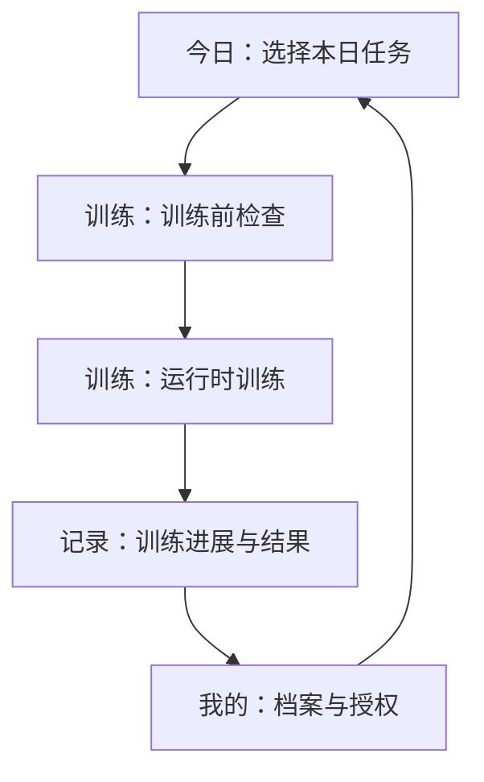
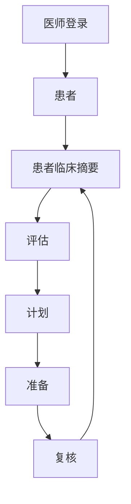
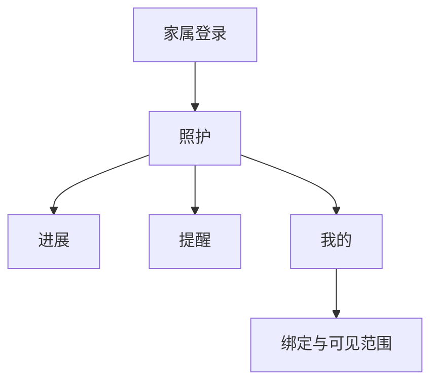
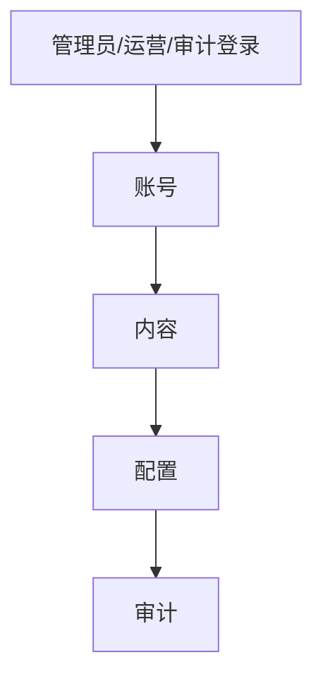

# 阿尔茨海默病 AI+体感康复平台 角色流程图与页面清单

## 1. 文档说明

- 文档版本：`v0.1`
- 文档用途：用于信息架构设计、低保真原型、前端页面拆分、路由规划与版本排期
- 依赖文档：[rehab-platform-mvp-prd.md](/Users/thl/IdeaProjects/Rehabilitation platform/docs/rehab-platform-mvp-prd.md)
- 当前 UI 推翻重做最终执行以 `docs/superpowers/plans/2026-06-10-minimal-premium-ui-master-closure-plan.md` 为准，执行名称为 `Complete Minimal Premium UI Overhaul`。`docs/superpowers/plans/2026-06-09-minimal-premium-ui-complete-overhaul-plan.md` 仅作为历史重置证据。角色流程必须服务潜在患病风险测量、多方案干预、可靠数据采集和简单游戏训练分类；患者可见训练分类必须精确保留 `思维训练` 与 `运动训练`，不得回到演示型、技术型或游戏复杂度优先的信息架构。

## 2. 设计原则

本项目的页面与流程设计遵循以下原则：

1. 先闭环，后扩展。
2. 患者端强调低认知负担，不让用户在多入口间迷失。
3. 医师端强调高信息密度与决策效率。
4. 家属端强调提醒、摘要与可解释，不承担专业判断。
5. 管理员端强调可控、可审计、可维护，而不是业务中枢。
6. 四个角色共享底层能力，但不共享相同的信息密度和交互复杂度。

## 3. 全局信息架构建议

建议全平台按“统一基础层 + 角色业务层 + 平台治理层”设计。

### 3.0 当前一次性交付信息架构

当前 Web 产品已经收敛为统一登录后的四类角色工作流：

| 角色 | 一级入口 | 交付边界 |
|---|---|---|
| 患者 | `今日 -> 训练 -> 记录 -> 我的` | 只展示任务、准备、训练反馈、档案授权和家属绑定；不展示引擎、审计、原始证据、供应商 payload 或导出治理。 |
| 医师 | `患者 -> 评估 -> 计划 -> 准备 -> 复核` | 处理负责患者、临床摘要、AI/量表/STT 证据复核、康复计划调整、正式训练准备创建和异常训练复核；不能绕过授权、采集批次、训练内容发布或人工复核要求。 |
| 管理员 | `账号 -> 内容 -> 配置 -> 审计` | 管理账号审核、训练内容、AI/STT/TTS/Unity/browser pose 配置可见性、脱敏导出和审计日志；供应商和导出治理作为配置/审计下的二级能力，统计只作为治理页内摘要，来自已存正式记录和审计事件，不补造缺失日期或指标。 |
| 家属 | `照护 -> 进展 -> 提醒 -> 我的` | 仅查看患者授权范围内的脱敏摘要、医生注意事项、私有照护圈互动和可见权限说明；不展示原始评估转写、原始动作指标、审计 ID 或导出入口。 |

公开社交广场不作为本期完成范围。本期交付的是私有照护圈；公开社交需客户确认可见人群、审核责任、举报/拉黑流程、隐私协议、临床隐私审查、审计和留存策略后另行验收。

The redesigned Web UI keeps formal delivery gates but hides runtime/provider/audit evidence from patient and caregiver screens. Evidence remains available through administrator/auditor workflows and acceptance scripts. For the total UI rebuild, technical/runtime/audit evidence belongs to admin/auditor workflows only; patient, caregiver, and doctor primary flows must stay business-facing and must not become delivery or technology consoles.

技术/运行时/审计证据只属于管理员和审计员治理页；患者、家属和医师主流程只展示业务任务、临床摘要、授权范围和可执行动作。

### 3.1 统一基础层

- 登录与身份切换
- 用户协议与隐私同意
- 消息通知
- 个人中心
- 帮助与反馈

### 3.2 角色业务层

- 患者端：今日任务、训练准备/运行、训练记录、我的资料与授权
- 医师端：患者、评估、计划、准备、复核
- 家属端：照护、进展、提醒、我的与授权范围
- 管理员端：账号、内容、配置、审计；供应商 readiness 和脱敏导出分别收纳在配置与审计内，统计查询仅作为治理页内摘要

### 3.3 平台治理层

- RBAC 权限控制
- 同意与授权留痕
- 脱敏展示
- 审计日志
- 设备与内容状态
- 基础报表与告警

## 4. 患者端

### 4.1 患者端定位

患者端 MVP 只解决三件事：

1. 完成评估
2. 执行当期训练
3. 查看训练结果与历史记录

### 4.2 患者端主流程

### 4.3 患者端异常流程

1. 未绑定患者档案：进入平台后直接落到 `患者建档页`，不允许直接进入训练。
2. 未完成知情同意或设备授权：拦截进入评估和训练，跳转 `知情同意与设备授权页`。
3. 麦克风权限被拒绝：在 `AI评估页` 提示重新授权；若本次评估要求真实语音能力，则阻断语音转写并提示改期或由医师选择非语音评估流程。
4. 摄像头权限被拒绝：在 `训练项目详情页` 或 `训练进行页` 提示重新授权；若项目必须体感，则禁止开始。
5. 评估中断或失败：进入 `评估中断页` 或在 `AI评估页` 内弹错，支持重新评估或稍后继续。
6. 当前无可执行训练计划：在 `今日训练页` 显示“当前暂无训练任务”，引导等待医师下发。
7. 训练过程中识别异常或设备不可用：在 `训练进行页` 提示校准、重试或结束本次训练。
8. 训练中途退出：二次确认退出，记录 `未完成` 状态并返回 `今日训练页`。
9. 训练结果上传失败：在 `训练反馈页` 提示“结果同步中/同步失败”，支持重试。训练结果上传失败不得进入记录页成功结果、不得计入完成训练。

### 4.4 患者端工作区清单

登录后直接进入角色工作区，不设置营销式欢迎页或独立演示页。患者 P0 固定为四个工作区：

| 优先级 | 工作区 | 页面目标 | 主要入口 | 核心模块 |
|---|---|---|---|---|
| P0 | 今日工作区 | 展示当前生效计划、今日任务、阻断原因和唯一主 CTA | 登录后默认、底部导航 | 今日任务、计划摘要、训练入口、等待医师下发状态 |
| P0 | 训练工作区 | 完成训练准备、运行时训练和结果确认 | 今日工作区主 CTA | 准备检查、授权状态、训练运行时、训练完成动作 |
| P0 | 记录工作区 | 查看本次结果、历史训练、医生反馈和计划库 | 训练完成后、底部导航 | 训练反馈、历史列表、趋势摘要、思维/运动训练库 |
| P0 | 我的工作区 | 查看档案、隐私同意、设备授权、家属绑定和可见范围 | 底部导航 | 档案摘要、授权状态、家属绑定、可见范围说明 |
| P1 | 帮助与权限调试 | 在权限异常或使用困难时提供辅助 | 工作区内异常入口 | 摄像头/麦克风授权、站位说明、简短帮助 |

### 4.5 患者端导航建议

当前患者端控制为 4 个一级入口：

- `今日`
- `训练`
- `记录`
- `我的`

患者端文案必须是业务语言，禁止出现 `engine`、`license`、`sensing`、`MediaPipe`、`Phaser`、`manifest`、`bridge`、`audit ID`、原始 evidence、provider payload 或导出治理等内部术语。

## 5. 医师端

### 5.1 医师端定位

医师端是 MVP 的核心角色端，主要完成：

1. 患者管理
2. 评估查看与风险确认
3. 康复计划下发与调整
4. 训练结果回看与异常干预

### 5.2 医师端主流程

### 5.3 医师端异常流程

1. 患者未完成初始评估：不可下发正式训练计划，只能提示补评或人工补录判断。
2. 评估失败或数据缺失：标记失败，支持重新评估。
3. 风险等级被人工修正：必须保留系统原值、人工修正值与修正原因。
4. 当前计划已暂停或结束：患者不可继续训练，医师需恢复、重配或新建版本。
5. 训练结果持续异常：如连续未完成、分数持续下降、长期未训练，进入异常视图并触发人工干预。
6. 结果回传失败：不可默认为完成，应显示 `待补偿/待同步` 状态。待补偿/待同步不得作为医生复核或正式业务链完成条件。
7. 越权访问：医师不可查看非本人负责患者数据。
8. 高风险患者关键计划变更：需明确确认后生效。

### 5.4 医师端页面清单

| 优先级 | 页面名称 | 页面目标 | 主要入口 | 核心模块 |
|---|---|---|---|---|
| P0 | 医师登录页 | 医师身份认证进入工作台 | 首次进入 | 登录表单、身份校验 |
| P0 | 患者列表页 | 查看本人负责患者并快速检索 | 登录后默认首页 | 列表、搜索、筛选、待处理标记 |
| P0 | 患者新建/编辑页 | 建档或补充患者信息 | 患者列表页 | 基础资料、照护关系、状态设置 |
| P0 | 患者详情总览页 | 汇总查看患者当前状态 | 患者列表页 | 基础资料、最近评估、当前计划、训练概览 |
| P0 | 评估结果页 | 查看初始评估和历史评估 | 患者详情总览页 | 评估摘要、结构化结果、历史记录 |
| P0 | 风险分级确认页 | 确认或修正系统风险等级 | 评估结果页 | 风险等级、判断依据、人工修正 |
| P0 | 康复计划确认/编辑页 | 确认、修改、下发生效计划 | 风险分级确认页 | 计划周期、频次、时长、项目组合、难度 |
| P0 | 训练记录与结果页 | 查看单次与阶段训练结果 | 患者详情页、计划页 | 记录列表、阶段概览、异常标记 |
| P0 | 异常提醒/待处理页 | 集中处理异常训练结果与未完成任务 | 患者详情页、工作台 | 待处理列表、异常类型、处理动作 |
| P1 | 患者分组页 | 管理患者分组和标签 | 患者列表页 | 分组、标签、批量筛选 |
| P1 | 计划模板页 | 复用训练方案模板 | 计划编辑页 | 模板列表、复制、编辑 |
| P1 | 阶段趋势分析页 | 查看阶段变化趋势 | 训练记录页 | 趋势图、周期对比、结果摘要 |
| P2 | 高级统计报表页 | 进行更深层分析 | 医师工作台 | 高级筛选、导出、交叉分析 |
| P2 | 多机构协同页 | 处理跨机构协作 | 高级功能入口 | 多机构视图、协同记录 |
| P2 | AI 推荐解释页 | 展示更细的 AI 匹配原因 | 计划页 | 推荐原因、解释卡片、置信度 |

## 6. 家属端

### 6.1 家属端定位

家属端在 MVP 中属于 `P1 辅助角色`，主要目标是：

1. 查看患者训练计划摘要
2. 接收提醒
3. 查看训练进展
4. 辅助患者完成训练

### 6.2 家属端主流程

### 6.3 家属端异常流程

1. 未授权或授权失效：不可查看患者数据，只能进入绑定/授权引导。
2. 授权被撤回：立即停止查看进展、提醒和共享信息。
3. 患者暂无生效计划：显示 `待医师下发`，而不是空白页。
4. 今日训练未完成：家属在提醒中看到提示，但不能替代医师修改计划。
5. 训练中断或结果异常：家属只看到“建议联系医师/关注状态”的提示，不展示完整专业判断。
6. 患者隐私限制：默认不可查看完整病史与全部原始评估输入。
7. 账号绑定错误患者：需走解绑或重新授权流程。

### 6.4 家属端页面清单

| 优先级 | 页面名称 | 页面目标 | 主要入口 | 核心模块 |
|---|---|---|---|---|
| P1 | 家属登录页 | 家属身份认证 | 首次进入 | 登录表单、账号校验 |
| P1 | 绑定患者/授权确认页 | 建立查看关系 | 登录后默认进入 | 患者绑定、授权确认、状态提示 |
| P1 | 照护页 | 查看患者当前照护摘要 | 绑定完成后 | 今日状态、是否完成、提醒摘要 |
| P1 | 训练计划摘要页 | 查看当前训练计划与安排 | 家属首页 | 计划概览、时长、频次、注意事项 |
| P1 | 训练完成情况页 | 查看近期训练执行情况 | 家属首页 | 已完成/未完成、最近结果、趋势摘要 |
| P1 | 提醒页 | 查看医生注意事项、训练提醒和异常关注 | 照护 | 未完成提醒、异常提示、注意事项 |
| P1 | 我的页 | 查看绑定关系与可见范围 | 照护 | 绑定关系、授权状态、可见范围 |
| P2 | 多患者切换页 | 管理多个患者关系 | 家属首页 | 患者切换、授权状态 |
| P2 | 留言鼓励/协作互动页 | 对患者进行鼓励互动 | 训练完成情况页 | 留言、鼓励、互动记录 |
| P2 | 历史提醒页 | 查看所有历史提醒和注意事项 | 提醒页 | 消息归档、时间筛选 |

### 6.5 家属端上线建议

本期家属端已经作为授权范围内的私有照护中心交付：

- `照护`：授权患者摘要、今日提醒和下一步动作。
- `进展`：脱敏趋势、当前计划和近 7 天摘要。
- `提醒`：医生注意事项、训练提醒和异常关注提示。
- `我的`：绑定关系、可见范围和授权说明。

家属端不承担临床判断，不展示原始评估 payload、原始动作指标、审计 ID、完整导出或后台治理入口。

## 7. 管理员端

### 7.1 管理员端定位

管理员端在 MVP 中不是业务决策中心，而是基础运营与风控后台。

主要目标：

1. 账号可控
2. 内容可用
3. 供应商和运行时配置可核验
4. 操作、审计和脱敏导出可治理

### 7.2 管理员端主流程

### 7.3 管理员端异常流程

1. 登录失败或账号冻结：提示原因，联系上级管理员复核，解冻或重置密码后重新登录。
2. 重复账号或角色冲突：创建时发现冲突，合并或复用原账号后重新绑定角色。
3. 越权访问敏感数据：系统拒绝并记录审计日志，如确需访问，需走合规授权审批。
4. 内容误下线导致训练不可执行：检查内容状态，恢复启用或回滚版本，并记录变更。
5. 摄像头环境、训练运行时或供应商 readiness 异常：定位现场或配置责任人，恢复后重新校验。
6. 审计查询不到关键记录：判断是筛选问题还是记录异常，上报技术排查并补充留痕。
7. 批量导入失败：返回错误明细，修正格式后重试，并保留失败记录。

### 7.4 管理员端页面清单

| 优先级 | 页面名称 | 页面目标 | 主要入口 | 核心模块 |
|---|---|---|---|---|
| P0 | 管理员登录页 | 管理员身份认证 | 首次进入 | 登录表单、风控校验 |
| P0 | 账号治理页 | 管理账号启用、冻结、重置和权限范围 | 登录后默认首页 | 搜索、创建、状态控制、角色范围 |
| P0 | 内容治理页 | 上下架、启停、维护训练内容 | 账号治理页 | 内容列表、启停、适用范围 |
| P0 | 配置治理页 | 查看 AI/STT/TTS、Unity WebGL 和 browser pose readiness | 内容治理页 | 小米 MiMo 配置、运行时状态、验收证据入口 |
| P0 | 安全审计页 | 查询关键操作记录并管理脱敏导出 | 配置治理页 | 时间筛选、用户筛选、对象筛选、导出原因、审计反查 |
| P1 | 运营统计摘要页 | 查看系统运行摘要 | 治理页内摘要入口 | 账号规模、内容状态、供应商 readiness、最近告警 |
| P1 | 批量导入/导出页 | 处理批量数据操作 | 账号或内容页 | 模板下载、导入结果、导出 |
| P1 | 告警中心页 | 处理离线与异常事件 | 后台首页 | 告警列表、状态流转、处理结果 |
| P1 | 操作详情页 | 查看单次管理员操作详情 | 审计日志页 | 变更前后摘要、结果、操作来源 |
| P1 | 内容版本记录页 | 记录训练内容版本变更 | 训练内容管理页 | 版本历史、回滚记录 |
| P2 | 多机构管理页 | 支持多机构场景 | 后台首页 | 机构列表、隔离配置 |
| P2 | 高级报表中心页 | 查看深层运营分析 | 后台首页 | 趋势、利用率、角色活跃度 |
| P2 | 合规授权审批页 | 处理敏感数据访问审批 | 审计/风控入口 | 审批流、授权记录 |
| P2 | 通知中心页 | 发布系统公告与维护通知 | 系统配置页 | 公告、消息、推送范围 |

### 7.5 管理员端导航建议

当前管理员后台控制在 4 个一级入口：

- `账号`
- `内容`
- `配置`
- `审计`

供应商 readiness 收纳在 `配置`，脱敏导出收纳在 `审计`。运营统计只能作为治理页内摘要。管理员端可以展示训练运行时、供应商 readiness、脱敏导出和审计信息；这些技术和治理信息不得下沉到患者端或家属端。

## 8. 四角色整体页面优先级建议

### 8.1 第一阶段首发建议

建议第一阶段优先上线：

- 患者端 `P0` 全链路
- 医师端 `P0` 全链路
- 管理员端最小 `P0`

### 8.2 第二阶段增强建议

建议第二阶段上线：

- 家属端 `P1` 最小协同能力
- 患者端 `P1`
- 医师端 `P1`
- 管理员端 `P1`

### 8.3 第三阶段扩展建议

建议第三阶段再进入：

- Unity 多游戏扩展
- AI 个性化推荐深化
- 多机构能力
- 高级分析报表
- 家庭互动与激励体系
- 公开社交广场。该能力必须先确认可见人群、审核机制、举报/拉黑流程、隐私协议、临床隐私审查、审计和留存责任。
- 穿戴设备生理指标采集。该能力必须先确认设备型号、SDK/API/协议、采样规则、指标阈值、授权范围和现场证据；未确认前不采集、不展示、不宣称。

## 9. 页面拆分建议

为了便于研发与设计同步推进，后续每个页面建议继续补 5 个维度：

1. 页面目标
2. 页面入口
3. 核心模块
4. 权限边界
5. 页面跳转关系

## 10. 下一步建议

在本文件基础上，建议直接继续输出：

1. `低保真页面目录`
2. `页面跳转关系表`
3. `角色目标 + 页面目标 + 页面字段建议`
4. `前端路由与模块拆分草案`
