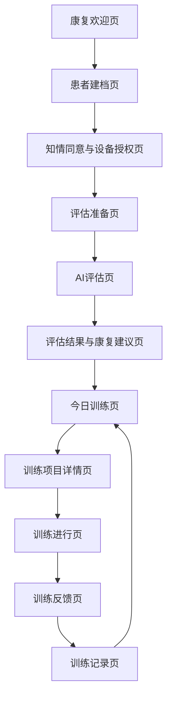
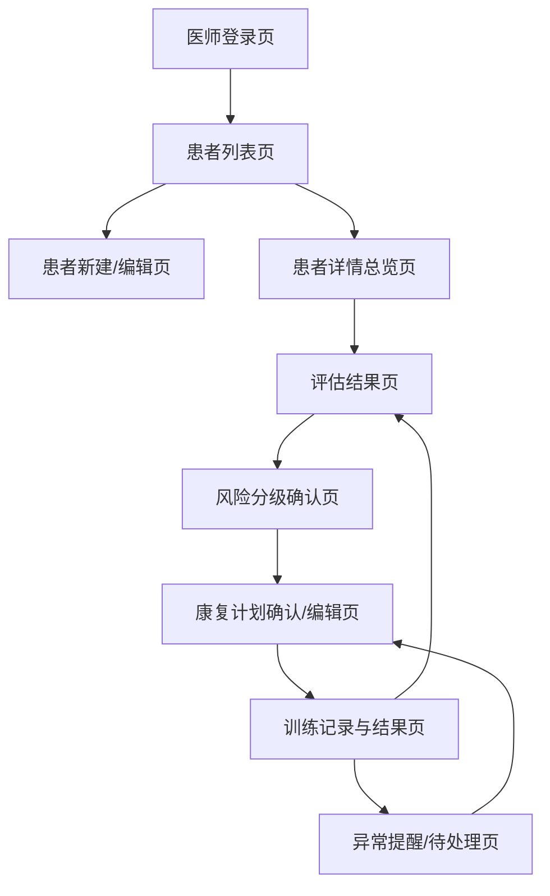
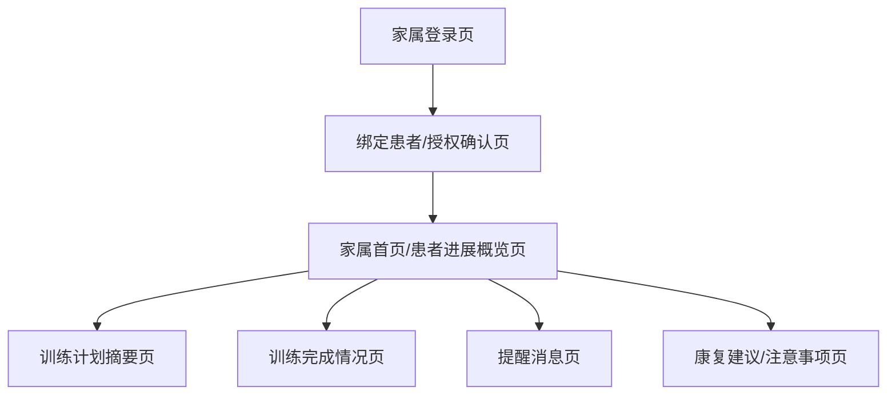
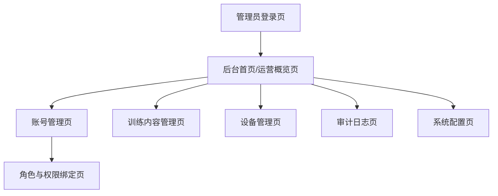

# 阿尔茨海默病 AI+体感康复平台 角色流程图与页面清单

## 1. 文档说明

- 文档版本：`v0.1`
- 文档用途：用于信息架构设计、低保真原型、前端页面拆分、路由规划与版本排期
- 依赖文档：[rehab-platform-mvp-prd.md](/Users/thl/IdeaProjects/Rehabilitation platform/docs/rehab-platform-mvp-prd.md)

## 2. 设计原则

本项目的页面与流程设计遵循以下原则：

1. 先闭环，后扩展。
2. 患者端强调低认知负担，不让用户在多入口间迷失。
3. 医师端强调高信息密度与决策效率。
4. 家属端强调提醒、摘要与可解释，不承担专业判断。
5. 管理员端强调可控、可审计、可维护，而不是业务中枢。
6. 四个角色共享底层能力，但不共享相同的信息密度和交互复杂度。

## 3. 全局信息架构建议

建议全平台按“统一基础层 + 角色业务层 + 平台治理层”设计。

### 3.1 统一基础层

- 登录与身份切换
- 用户协议与隐私同意
- 消息通知
- 个人中心
- 帮助与反馈

### 3.2 角色业务层

- 患者端：评估、计划、训练、结果、记录
- 医师端：患者管理、评估查看、风险确认、计划管理、训练回看
- 家属端：授权绑定、提醒、摘要、进展查看
- 管理员端：账号、角色、内容、设备、审计、配置

### 3.3 平台治理层

- RBAC 权限控制
- 同意与授权留痕
- 脱敏展示
- 审计日志
- 设备与内容状态
- 基础报表与告警

## 4. 患者端

### 4.1 患者端定位

患者端 MVP 只解决三件事：

1. 完成评估
2. 执行当期训练
3. 查看训练结果与历史记录

### 4.2 患者端主流程

### 4.3 患者端异常流程

1. 未绑定患者档案：进入平台后直接落到 `患者建档页`，不允许直接进入训练。
2. 未完成知情同意或设备授权：拦截进入评估和训练，跳转 `知情同意与设备授权页`。
3. 麦克风权限被拒绝：在 `AI评估页` 提示重新授权，必要时提供简化作答兜底。
4. 摄像头权限被拒绝：在 `训练项目详情页` 或 `训练进行页` 提示重新授权；若项目必须体感，则禁止开始。
5. 评估中断或失败：进入 `评估中断页` 或在 `AI评估页` 内弹错，支持重新评估或稍后继续。
6. 当前无可执行训练计划：在 `今日训练页` 显示“当前暂无训练任务”，引导等待医师下发。
7. 训练过程中识别异常或设备不可用：在 `训练进行页` 提示校准、重试或结束本次训练。
8. 训练中途退出：二次确认退出，记录 `未完成` 状态并返回 `今日训练页`。
9. 训练结果上传失败：在 `训练反馈页` 提示“结果同步中/同步失败”，支持重试。

### 4.4 患者端页面清单

| 优先级 | 页面名称 | 页面目标 | 主要入口 | 核心模块 |
|---|---|---|---|---|
| P0 | 康复欢迎页 | 平台入口、身份确认、进入主闭环 | 首次进入 | 开始使用、角色识别、帮助入口 |
| P0 | 患者建档页 | 基础信息录入、档案绑定 | 首次进入、未建档拦截 | 基础资料表单、患者身份确认 |
| P0 | 知情同意与设备授权页 | 完成隐私同意、麦克风/摄像头授权 | 建档后、功能拦截 | 协议勾选、权限申请、授权状态 |
| P0 | 评估准备页 | 说明评估流程与注意事项 | 同意后 | 评估说明、时长说明、开始按钮 |
| P0 | AI评估页 | 完成认知/动作评估 | 评估准备页 | 问答、量表、语音/动作采集 |
| P0 | 评估结果与康复建议页 | 展示结果、风险分层、推荐训练 | 评估完成后 | 结果摘要、风险等级、计划建议 |
| P0 | 今日训练页 | 展示当前生效计划与待完成任务 | 评估结果页、首页主入口 | 今日任务、计划摘要、训练入口 |
| P0 | 训练项目详情页 | 展示单项训练说明与开始入口 | 今日训练页 | 训练目标、时长、难度、开始前说明 |
| P0 | 训练进行页 | 执行体感或认知训练 | 训练项目详情页 | 实时引导、状态控制、体感交互 |
| P0 | 训练反馈页 | 展示本次训练结果与下一步动作 | 训练完成后 | 得分、完成度、鼓励反馈、重试/返回 |
| P0 | 训练记录页 | 查看历史训练记录和完成情况 | 今日训练页、训练反馈页 | 训练列表、时间筛选、简单趋势 |
| P1 | 我的档案页 | 查看基础信息、身体情况、重新评估入口 | 顶部个人入口 | 基础资料、授权状态、重新评估 |
| P1 | 使用帮助页 | 提供快速教程与常见问题 | 帮助入口 | 新手引导、FAQ、联系客服 |
| P1 | 设备调试页 | 查看摄像头预览和体感校准 | 权限异常入口 | 权限状态、摄像头预览、校准说明 |
| P1 | 评估中断页 | 处理中断、失败、稍后继续 | 评估异常时 | 错误提示、重试、返回 |
| P2 | 康复进展页 | 查看周/月阶段进展 | 训练记录页 | 趋势图、阶段变化、建议 |
| P2 | 激励成就页 | 展示连续训练与鼓励机制 | 患者个人中心 | 成就、徽章、激励反馈 |
| P2 | 家庭协同邀请页 | 邀请家属接收提醒 | 我的档案页 | 邀请、授权、分享 |
| P2 | 分享反馈页 | 分享结果给家属或医生 | 训练反馈页 | 分享摘要、授权确认 |

### 4.5 患者端导航建议

建议患者端 MVP 控制在 3 到 4 个一级入口：

- `今日训练`
- `训练记录`
- `我的档案`
- `帮助`

如果还要进一步收敛，可以缩减为：

- `今日训练`
- `训练记录`
- `我的`

## 5. 医师端

### 5.1 医师端定位

医师端是 MVP 的核心角色端，主要完成：

1. 患者管理
2. 评估查看与风险确认
3. 康复计划下发与调整
4. 训练结果回看与异常干预

### 5.2 医师端主流程

### 5.3 医师端异常流程

1. 患者未完成初始评估：不可下发正式训练计划，只能提示补评或人工补录判断。
2. 评估失败或数据缺失：标记失败，支持重新评估。
3. 风险等级被人工修正：必须保留系统原值、人工修正值与修正原因。
4. 当前计划已暂停或结束：患者不可继续训练，医师需恢复、重配或新建版本。
5. 训练结果持续异常：如连续未完成、分数持续下降、长期未训练，进入异常视图并触发人工干预。
6. 结果回传失败：不可默认为完成，应显示 `待补偿/待同步` 状态。
7. 越权访问：医师不可查看非本人负责患者数据。
8. 高风险患者关键计划变更：需明确确认后生效。

### 5.4 医师端页面清单

| 优先级 | 页面名称 | 页面目标 | 主要入口 | 核心模块 |
|---|---|---|---|---|
| P0 | 医师登录页 | 医师身份认证进入工作台 | 首次进入 | 登录表单、身份校验 |
| P0 | 患者列表页 | 查看本人负责患者并快速检索 | 登录后默认首页 | 列表、搜索、筛选、待处理标记 |
| P0 | 患者新建/编辑页 | 建档或补充患者信息 | 患者列表页 | 基础资料、照护关系、状态设置 |
| P0 | 患者详情总览页 | 汇总查看患者当前状态 | 患者列表页 | 基础资料、最近评估、当前计划、训练概览 |
| P0 | 评估结果页 | 查看初始评估和历史评估 | 患者详情总览页 | 评估摘要、结构化结果、历史记录 |
| P0 | 风险分级确认页 | 确认或修正系统风险等级 | 评估结果页 | 风险等级、判断依据、人工修正 |
| P0 | 康复计划确认/编辑页 | 确认、修改、下发生效计划 | 风险分级确认页 | 计划周期、频次、时长、项目组合、难度 |
| P0 | 训练记录与结果页 | 查看单次与阶段训练结果 | 患者详情页、计划页 | 记录列表、阶段概览、异常标记 |
| P0 | 异常提醒/待处理页 | 集中处理异常训练结果与未完成任务 | 患者详情页、工作台 | 待处理列表、异常类型、处理动作 |
| P1 | 患者分组页 | 管理患者分组和标签 | 患者列表页 | 分组、标签、批量筛选 |
| P1 | 计划模板页 | 复用训练方案模板 | 计划编辑页 | 模板列表、复制、编辑 |
| P1 | 阶段趋势分析页 | 查看阶段变化趋势 | 训练记录页 | 趋势图、周期对比、结果摘要 |
| P2 | 高级统计报表页 | 进行更深层分析 | 医师工作台 | 高级筛选、导出、交叉分析 |
| P2 | 多机构协同页 | 处理跨机构协作 | 高级功能入口 | 多机构视图、协同记录 |
| P2 | AI 推荐解释页 | 展示更细的 AI 匹配原因 | 计划页 | 推荐原因、解释卡片、置信度 |

## 6. 家属端

### 6.1 家属端定位

家属端在 MVP 中属于 `P1 辅助角色`，主要目标是：

1. 查看患者训练计划摘要
2. 接收提醒
3. 查看训练进展
4. 辅助患者完成训练

### 6.2 家属端主流程

### 6.3 家属端异常流程

1. 未授权或授权失效：不可查看患者数据，只能进入绑定/授权引导。
2. 授权被撤回：立即停止查看进展、提醒和共享信息。
3. 患者暂无生效计划：显示 `待医师下发`，而不是空白页。
4. 今日训练未完成：家属收到提醒，但不能替代医师修改计划。
5. 训练中断或结果异常：家属只看到“建议联系医师/关注状态”的提示，不展示完整专业判断。
6. 患者隐私限制：默认不可查看完整病史与全部原始评估输入。
7. 账号绑定错误患者：需走解绑或重新授权流程。

### 6.4 家属端页面清单

| 优先级 | 页面名称 | 页面目标 | 主要入口 | 核心模块 |
|---|---|---|---|---|
| P1 | 家属登录页 | 家属身份认证 | 首次进入 | 登录表单、账号校验 |
| P1 | 绑定患者/授权确认页 | 建立查看关系 | 登录后默认进入 | 患者绑定、授权确认、状态提示 |
| P1 | 家属首页/患者进展概览页 | 查看患者当前训练概况 | 绑定完成后 | 今日状态、是否完成、提醒摘要 |
| P1 | 训练计划摘要页 | 查看当前训练计划与安排 | 家属首页 | 计划概览、时长、频次、注意事项 |
| P1 | 训练完成情况页 | 查看近期训练执行情况 | 家属首页 | 已完成/未完成、最近结果、趋势摘要 |
| P1 | 提醒消息页 | 接收训练提醒和异常提示 | 家属首页 | 未完成提醒、异常提示、消息列表 |
| P1 | 康复建议/注意事项页 | 查看辅助照护建议 | 家属首页 | 注意事项、陪护建议、联系医师提示 |
| P2 | 多患者切换页 | 管理多个患者关系 | 家属首页 | 患者切换、授权状态 |
| P2 | 留言鼓励/协作互动页 | 对患者进行鼓励互动 | 训练完成情况页 | 留言、鼓励、互动记录 |
| P2 | 历史消息中心页 | 查看所有历史提醒 | 提醒消息页 | 消息归档、时间筛选 |

### 6.5 家属端上线建议

如果只做最小首发：

- 家属端不作为第一阶段核心首发闭环
- 建议第二步先上线以下 4 个页面：
  - `绑定患者/授权确认页`
  - `家属首页/患者进展概览页`
  - `训练计划摘要页`
  - `提醒消息页`

## 7. 管理员端

### 7.1 管理员端定位

管理员端在 MVP 中不是业务决策中心，而是基础运营与风控后台。

主要目标：

1. 账号可控
2. 内容可用
3. 设备可巡检
4. 操作可审计

### 7.2 管理员端主流程

### 7.3 管理员端异常流程

1. 登录失败或账号冻结：提示原因，联系上级管理员复核，解冻或重置密码后重新登录。
2. 重复账号或角色冲突：创建时发现冲突，合并或复用原账号后重新绑定角色。
3. 越权访问敏感数据：系统拒绝并记录审计日志，如确需访问，需走合规授权审批。
4. 内容误下线导致训练不可执行：检查内容状态，恢复启用或回滚版本，并记录变更。
5. 设备离线或摄像头环境异常：定位设备，通知现场处理，恢复后重新校验。
6. 审计查询不到关键记录：判断是筛选问题还是记录异常，上报技术排查并补充留痕。
7. 批量导入失败：返回错误明细，修正格式后重试，并保留失败记录。

### 7.4 管理员端页面清单

| 优先级 | 页面名称 | 页面目标 | 主要入口 | 核心模块 |
|---|---|---|---|---|
| P0 | 管理员登录页 | 管理员身份认证 | 首次进入 | 登录表单、风控校验 |
| P0 | 后台首页/运营概览页 | 查看系统运行总览 | 登录后默认首页 | 账号规模、内容状态、设备在线数、最近告警 |
| P0 | 账号管理页 | 管理账号启用、冻结、重置 | 后台首页 | 搜索、创建、状态控制 |
| P0 | 角色与权限绑定页 | 绑定角色并控制范围 | 账号管理页 | 角色分配、权限范围、状态 |
| P0 | 训练内容管理页 | 上下架、启停、维护训练内容 | 后台首页 | 内容列表、启停、适用范围 |
| P0 | 审计日志页 | 查询关键操作记录 | 后台首页 | 时间筛选、用户筛选、对象筛选 |
| P0 | 系统配置页 | 管理隐私协议版本与基础配置 | 后台首页 | 协议版本、同意规则、基础字典 |
| P1 | 设备管理页 | 查看设备在线状态 | 后台首页 | 设备列表、状态、异常标记 |
| P1 | 批量导入/导出页 | 处理批量数据操作 | 账号或内容页 | 模板下载、导入结果、导出 |
| P1 | 告警中心页 | 处理离线与异常事件 | 后台首页 | 告警列表、状态流转、处理结果 |
| P1 | 操作详情页 | 查看单次管理员操作详情 | 审计日志页 | 变更前后摘要、结果、操作来源 |
| P1 | 内容版本记录页 | 记录训练内容版本变更 | 训练内容管理页 | 版本历史、回滚记录 |
| P2 | 多机构管理页 | 支持多机构场景 | 后台首页 | 机构列表、隔离配置 |
| P2 | 高级报表中心页 | 查看深层运营分析 | 后台首页 | 趋势、利用率、角色活跃度 |
| P2 | 合规授权审批页 | 处理敏感数据访问审批 | 审计/风控入口 | 审批流、授权记录 |
| P2 | 通知中心页 | 发布系统公告与维护通知 | 系统配置页 | 公告、消息、推送范围 |

### 7.5 管理员端导航建议

建议管理员后台控制在 6 个一级导航：

- `首页`
- `账号`
- `内容`
- `设备`
- `审计`
- `设置`

## 8. 四角色整体页面优先级建议

### 8.1 第一阶段首发建议

建议第一阶段优先上线：

- 患者端 `P0` 全链路
- 医师端 `P0` 全链路
- 管理员端最小 `P0`

### 8.2 第二阶段增强建议

建议第二阶段上线：

- 家属端 `P1` 最小协同能力
- 患者端 `P1`
- 医师端 `P1`
- 管理员端 `P1`

### 8.3 第三阶段扩展建议

建议第三阶段再进入：

- Unity 多游戏扩展
- AI 个性化推荐深化
- 多机构能力
- 高级分析报表
- 家庭互动与激励体系

## 9. 页面拆分建议

为了便于研发与设计同步推进，后续每个页面建议继续补 5 个维度：

1. 页面目标
2. 页面入口
3. 核心模块
4. 权限边界
5. 页面跳转关系

## 10. 下一步建议

在本文件基础上，建议直接继续输出：

1. `低保真页面目录`
2. `页面跳转关系表`
3. `角色目标 + 页面目标 + 页面字段建议`
4. `前端路由与模块拆分草案`
